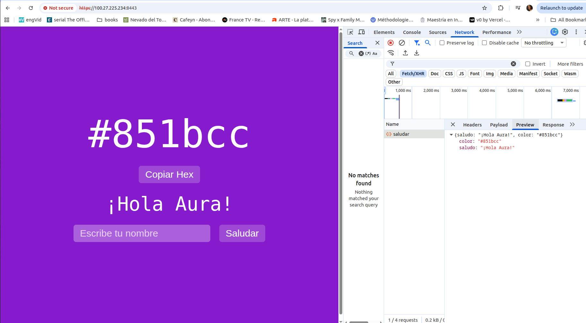

# FastAPI Web App con Jinja2, Amazon RDS y Despliegue en AWS EC2

Esta aplicación es un desarrollo web construido con **FastAPI**, **Jinja2**, HTML/CSS/JavaScript y una capa de persistencia en **Amazon RDS (PostgreSQL)**, desplegada en un servidor **AWS EC2** con soporte HTTPS.

---

## 📋 Estructura del Proyecto

```text
/
├── main.py              # Código principal de la API y lógica de rutas
├── crear_tabla.py       # Script auxiliar para inicializar la tabla en la base de datos
├── key.pem / cert.pem   # Certificados SSL locales / de prueba
├── .env.example         # Plantilla de variables de entorno
├── static/
│   ├── script.js        # Lógica frontend (fetch API y copiado al portapapeles)
│   └── style.css        # Estilos de la aplicación
└── templates/
    ├── base.html        # Plantilla base Jinja2
    └── color.html       # Vista principal e interfaz de usuario
```

# 1. Configuración de la Base de Datos (Amazon RDS PostgreSQL)

1. En la consola de AWS, dirígete a **Amazon RDS** y crea una base de datos PostgreSQL (*Dev/Test template*).
2. Asegúrate de configurar:
   - **DB instance identifier:** `fastapi-db`
   - **Master username:** `postgres`
   - **Public accessibility:** `Yes` (para permitir la comunicación con el servidor EC2).
   - **Enhanced monitoring:** Desactivado (según las restricciones del entorno sandbox).
3. Configura el **Security Group** de RDS para permitir tráfico entrante en el puerto `5432` proveniente del Security Group de tu instancia EC2.

## 2. Guía de Despliegue en AWS EC2 (Amazon Linux)

### Paso 1: Configurar el Security Group de EC2

Abre los siguientes puertos en las reglas de entrada (*Inbound Rules*) de tu instancia EC2:

- **SSH (Puerto 22):** Para acceso remoto.
- **Custom TCP (Puerto 8443):** Para el tráfico HTTPS directo de la aplicación.

### Paso 2: Conectarse al Servidor por SSH

```bash
chmod 400 tu-llave.pem
ssh -i "tu-llave.pem" ec2-user@<IP-PUBLICA-DE-EC2>
```

### Paso 3: Instalar Dependencias del Sistema

Actualiza el sistema e instala Python, Git y herramientas de desarrollo:

```bash
sudo dnf update -y
sudo dnf install python3-pip python3-devel git -y
```

### Paso 4: Clonar el Repositorio y Configurar el Entorno Virtual

```bash
git clone https://github.com/AuraAlba/taller-informatica
cd taller-informatica/

python3 -m venv venv
source venv/bin/activate

pip install "fastapi[standard]" psycopg2-binary python-dotenv uvicorn
```

### Paso 5: Configurar las Variables de Entorno (`.env`)

Crea un archivo `.env` en la raíz del proyecto con las credenciales de tu base de datos RDS:

```ini
DB_HOST=tu-endpoint-de-rds.us-east-1.rds.amazonaws.com
DB_NAME=postgres
DB_USER=postgres
DB_PASSWORD=tu_contraseña_real_de_rds
DB_PORT=5432
```

### Paso 6: Inicializar la Base de datos (Crear la Tabla)

Ejecuta el script auxiliar para crear la tabla requerida en PostgreSQL:

```bash
python crear_tabla.py
```

### Paso 7: Generar Certificados SSL Autofirmados (Para HTTPS)

Dado que las funciones modernas del navegador (como `navigator.clipboard`) exigen un entorno seguro, genera certificados locales apuntando a tu IP pública:

```vbnet
openssl genrsa -out key.pem 2048
openssl req -new -x509 -key key.pem -out cert.pem -days 365
```

*(Nota: Al solicitar el **Common Name**, introduce la **IP pública de tu instancia EC2**).*

### Paso 8: Configurar FastAPI como un Servicio del Sistema (`systemd`)

Para mantener la aplicación corriendo en segundo plano de manera persistente:

1. Crea el archivo de servicio:

   ```bash
   sudo nano /etc/systemd/system/fastapi.service
   ```

2. Pega la siguiente configuración (ajustando la ruta de tu repositorio):

   ```ini
   [Unit]
   Description=FastAPI Service con HTTPS en Amazon Linux
   After=network.target

   [Service]
   User=ec2-user
   WorkingDirectory=/home/ec2-user/taller-informatica
   ExecStart=/home/ec2-user/taller-informatica/venv/bin/python main.py
   Restart=always

   [Install]
   WantedBy=multi-user.target
   ```

3. Activa e inicia el servicio:

   ```bash
   sudo systemctl daemon-reload
   sudo systemctl start fastapi
   sudo systemctl enable fastapi
   ```

## 🌐 3. Uso de la Aplicación

Una vez completado el despliegue, abre tu navegador web e ingresa a:

```yaml
https://<IP-PUBLICA-DE-EC2>:8443/
```

*(Al usar un certificado autofirmado, acepta la advertencia de seguridad del navegador haciendo clic en "Avanzado" y luego en "Continuar").*

La aplicación generará colores aleatorios, te permitirá copiar códigos hexadecimales de forma segura mediante HTTPS y almacenará los saludos y registros en tu base de datos **Amazon RDS**. Se debe poder ver
de la siguiente manera:



